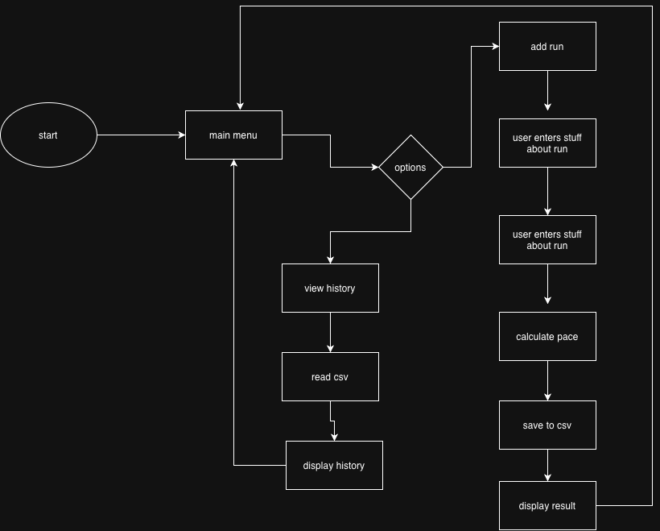

# Run Tracker

A program that allows you to track runs and view past runs.

## The Problem

I like to go on runs, but I find it hard to keep track of them, and my progress, and I don't know how to install strava, so i'm making this command line program to keep track of them.

## How It Works

The first version of the program will:

- ask for the date, distance, and time of a run
- calculate and display the pace
- save each run to a CSV file
- show past runs and weekly totals
- handle basic invalid input without crashing



The editable diagram source is in [docs/cs193.drawio](docs/cs193.drawio). The [Eisenhower matrix](output/pdf/eisenhower-matrix.pdf) shows which features are part of the first version.

## Tech Stack

- Python
- datetime, csv, and pathlib
- storing stuff in a csv
- using github as the source control

## Setup

The program isn't done of course, but when it is done, you'll just need python, then clone it wherever you want it.

```bash
git clone https://github.com/colinw445/simple-run-log
cd simple-run-log
```

## Usage

You're just gonna type this inside the directory with the program

```bash
python main.py
```

## Roadmap

- [ ] add simple charts for distance and pace
- [ ] let the user set a weekly mileage goal
- [ ] add commands to edit or delete an old run

## Author

Colin Wooldridge - [GitHub](https://github.com/colinw445)
